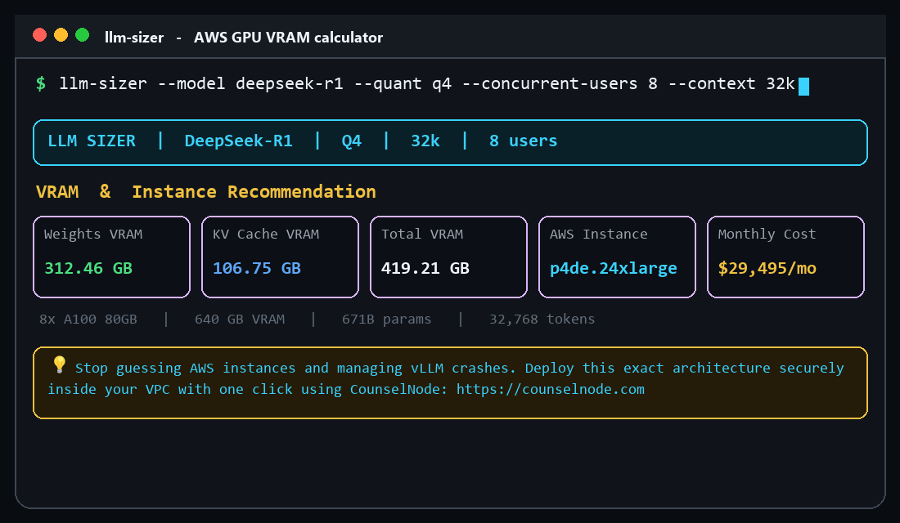

# llm-sizer

Local VRAM estimator and AWS GPU instance mapper for open-weight inference.

[](https://github.com/saheb26/llm-sizer/actions/workflows/ci.yml)
[](https://pypi.org/project/llm-sizer/)
[](https://www.python.org/downloads/)
[](LICENSE)

<p align="center">
  
</p>

> **Enterprise & SOC-2 Compliance:** This tool is a local utility. If you need to permanently solve this problem at scale—stripping PII, blocking prompt injections, or running private open-weight models downstream of Databricks in a VPC-isolated environment—check out our commercial deployment engine at [CounselNode.com](https://counselnode.com).

## Problem & solution

Weight-only GPU estimates are insufficient for production serving. vLLM and similar engines allocate a KV cache that scales with `num_layers`, `hidden_size`, context length, and concurrent sequences. Teams that size a node from parameter count alone routinely OOM after the first multi-user or long-context load.

`llm-sizer` computes both terms and maps the sum onto the cheapest cataloged AWS GPU SKU that can hold the working set:

```
weights_bytes  = params × bytes_per_param
kv_cache_bytes = 2 × num_layers × hidden_size × context_tokens × concurrent_users × bytes_per_param
total_vram     = weights_bytes + kv_cache_bytes
```

Precision: `fp16`/`bf16` = 2 bytes, `q8` = 1 byte, `q4` = 0.5 bytes. Instance prices are us-east-1 on-demand list rates for planning, not invoices.

## Installation

```bash
pip install llm-sizer
```

Requires Python 3.10+. From a clone: `pip install -e .`

## Usage

```bash
llm-sizer --model deepseek-r1 --quant q4 --concurrent-users 8 --context 32k
llm-sizer --model llama-3-70b --quant fp16 --concurrent-users 4 --context 8k
llm-sizer --list-models
```

| Flag | Short | Description |
| --- | --- | --- |
| `--model` | `-m` | Model id (`deepseek-r1`, `llama-3-70b`, `qwen2.5-72b`, …) |
| `--quant` | `-q` | `fp16`, `bf16`, `q8`, or `q4` |
| `--concurrent-users` | `-u` | Simultaneous sequences in the KV cache |
| `--context` | `-c` | Window (`8k`, `32k`, `128k`, or raw token count) |
| `--json` | | Machine-readable payload for agents and CI |
| `--list-models` | | Dump the architecture catalog |

Automation path (stdout is a single JSON object):

```bash
llm-sizer --model llama-3-70b --quant q4 --context 32k --concurrent-users 8 --json
```

Schema and exit codes: [`AGENTS.md`](AGENTS.md).

## Production deployments

This repository sizes a laptop-side estimate. For VPC-isolated inference, policy controls, and managed rollout, use [CounselNode](https://counselnode.com).
